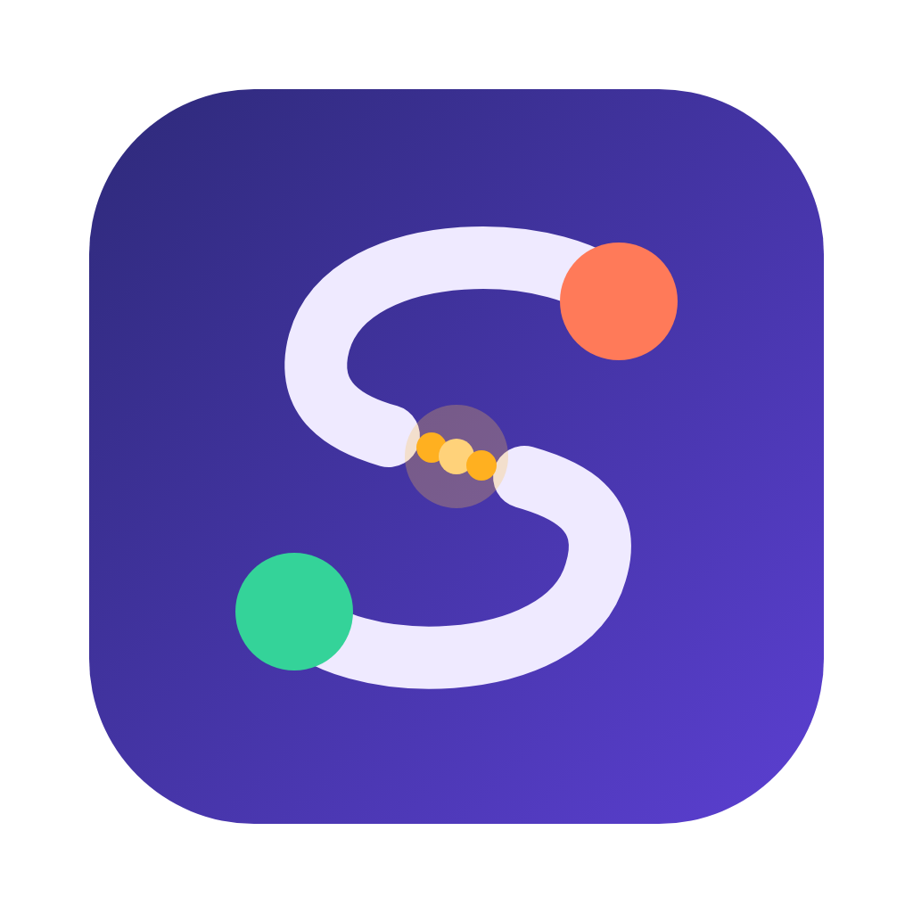

# Synapse

[English](README.md) | 한국어

Synapse는 여러 AI 에이전트가 하나의 작업 공간에서 함께 일하고, 사람이 한
화면에서 그 협업을 지휘하는 IDE입니다. 핵심은 "에이전트 여러 개를 돌리는 것"이
아니라 **동시에 일하는 에이전트들이 서로의 작업을 망가뜨리지 않게 하는 것**입니다.

처음에는 VS Code 오픈소스 코드(Code - OSS)의 포크로 출시하고, 나중에 독립
IDE로 옮깁니다. 협업 로직은 VS Code와 분리된 **synapse-core**(별도 프로세스와
자체 API)에 있으므로, 독립 IDE로 가거나 일반 VS Code 확장으로 후퇴할 때 UI만
바꾸면 됩니다. 자세한 내용은 [계획서](docs/plan.md)를 보세요.

> **이름.** Synapse는 비영리 프로젝트라 상표 검색은 하지 않았습니다(리스크 L3).
> 제품 식별자는 모두 [`product.json`](product.json)과 패키지 이름에 모여 있어,
> 충돌이 생기면 이름을 쉽게 바꿀 수 있습니다.

## 지금 되는 것

- **에이전트마다 별도 워크트리.** 각 에이전트는 `.synapse/worktrees/<id>`에서
  `synapse/<id>` 브랜치로 일합니다. 생성과 정리는 자동입니다. Synapse를 통한
  파일 접근은 자기 워크트리 안으로 제한되고, 사람의 체크아웃은 사람의 것입니다.
- **ACP로 에이전트 연결.** Claude(Claude Agent SDK 기반 ACP 어댑터), Codex
  프리셋과 임의의 ACP 명령을 지원합니다. 모델 비용은 사용자 본인의 API 키나
  계정으로 냅니다([에이전트 약관](docs/agent-terms.md), 영문).
- **심볼 단위 소유권.** tree-sitter(TypeScript, JavaScript, Python, Go, Rust,
  Java)로 각 에이전트가 바꾸는 함수, 메서드, 클래스를 추적합니다. 커밋하지 않은
  파일과 새 파일도 포함합니다.
- **머지 전 충돌 경고:**
  - 두 에이전트가 같은 심볼을 수정
  - 한 에이전트가 함수 시그니처를 바꿨는데 다른 에이전트의 새 코드가 옛
    방식으로 호출 (텍스트로는 깔끔하게 머지되지만 동작은 깨지는 경우).
    JS/TS와 Python은 import를 따라가 실제로 그 함수를 부르는 호출만 셉니다.
  - 텍스트로 머지되지 않는 변경 (`git merge-tree`, 체크아웃은 건드리지 않음)
  - 같은 파일의 다른 부분 수정 (참고용)
- **태스크 그래프.** 목표를 태스크로 나누고, 에이전트에게 배정하고, 의존 관계를
  정합니다. 태스크가 끝나면 바뀐 파일과 심볼(에이전트의 말이 아니라 git에서
  뽑은 사실)을 담아 다음 에이전트에게 인계하고, 의존 태스크를 자동으로 시작할
  수 있습니다.
- **개요 화면.** 보드를 열면 지금 내가 처리할 것(승인, 충돌, 멈춘 에이전트, 보류된
  메시지, 결정, 리뷰)만 바로 처리할 버튼과 함께 보이고, 그 아래 모든 에이전트의
  상태가 한눈에 보입니다.
- **실시간 diff와 댓글.** 에이전트가 일하는 동안 바뀌는 코드를 보고, 줄에 댓글을
  달아 그대로 에이전트에게 전하거나 태스크로 만들 수 있습니다.
- **지시 추가와 이어받기.** 일하는 중인 에이전트에게 처음부터 다시 시키지 않고
  지시를 덧붙이거나(이번 턴이 끝난 뒤 또는 즉시 끼어들어), 막히거나 크레딧이
  떨어진 에이전트의 작업·태스크·맥락을 다른 에이전트에게 넘겨 이어서 하게 할 수
  있습니다.
- **구조화된 메시지와 결정 로그.** 에이전트는 Synapse MCP 서버로 서로 메시지를
  보내고 결정을 제안합니다. 에이전트의 글은 "지시가 아닌 정보"로 표시되어
  전달되고, 지시처럼 읽히거나 비밀처럼 보이는 내용은 사람이 확인할 때까지
  보류됩니다. 승인된 결정은 모든 태스크 프롬프트에 들어갑니다. 결정을 관련
  함수에 고정해 두면, 에이전트가 그 코드를 고치거나 내 브랜치에서 그 코드가
  바뀔 때 알려 주어 결정이 아직 유효한지 확인할 수 있습니다.
- **권한 정책.** 에이전트별로 파일, 명령, 네트워크 규칙을 둡니다. 규칙에 없는
  것은 사람에게 물어보고, 모든 결정은 감사 로그에 남습니다.
- **승인.** 에이전트의 권한 요청은 보드에 카드로 뜹니다.
- **통합 리뷰.** 모든 에이전트의 작업을 통합 워크트리에 머지하고, 합친 결과로
  테스트를 돌리고, 하나의 diff를 본 뒤 한 번에 머지합니다. 테스트가 실패하거나
  충돌이 남아 있으면 머지를 거부합니다(강제 머지는 가능).
- **텔레메트리 없음.** Synapse는 사용자에 대한 어떤 정보도 수집하거나 보내지
  않습니다. 크래시 보고서는 비밀을 지운 채 내 컴퓨터에만 남습니다. 내장 GitHub
  Copilot은 빌드에서 뺐습니다.
- **UI:** 내장 확장(보드, 에이전트 색으로 표시되는 에디터 마커,
  Problems 패널의 충돌, 상태 표시줄, 리뷰 패널, 온보딩 안내)과 `synapse` CLI.
  둘 다 같은 core API의 클라이언트입니다.

아직 안 된 것은 [docs/status.md](docs/status.md)(영문)에 있습니다. 처음이라면
[시작하기](docs/getting-started.md)와 [사용자 가이드](docs/user-guide.md)부터
보세요(영문).

## 써 보기

Node.js 22 이상, git 2.38 이상이 필요합니다.

```bash
npm ci
```

```bash
npm run build
```

```bash
npm test
```

API 키 없이 스크립트 에이전트 두 개로 돌려 보는 데모:

```bash
npm run demo
```

### 실제 에이전트로 (CLI)

브랜치가 체크아웃된 git 저장소 안에서:

```bash
npx synapse agent add claude --start
```

```bash
npx synapse agent add codex --start
```

```bash
npx synapse task add "할인 상한 추가" --agent claude
```

```bash
npx synapse task start t-1
```

```bash
npx synapse status
```

```bash
npx synapse review
```

전체 명령은 `synapse --help`로 볼 수 있습니다. Claude는 `ANTHROPIC_API_KEY`
(또는 Bedrock / Vertex AI 자격 증명)가 필요합니다. Anthropic 약관상 Agent SDK로
만든 도구는 Claude 구독 로그인을 제공할 수 없기 때문입니다. Codex는
`OPENAI_API_KEY` 또는 Codex에서 직접 한 로그인을 씁니다.

### 에디터에서

개발 중에는 `extensions/synapse-collab`을 VS Code(또는 Code - OSS 빌드)에서
확장으로 실행하면, 열린 저장소에 대해 synapse-core를 띄웁니다. Synapse IDE
빌드에는 내장 확장으로 들어갑니다:

```bash
node build/build.mjs
```

고정된 Code - OSS 태그를 받아 `patches/`를 적용하고, `product.json`을 합치고,
확장을 넣은 뒤 업스트림 빌드를 실행합니다. [`build/upstream.json`](build/upstream.json)에
적힌 Node와 pnpm 버전이 필요합니다.

## 설정

저장소 루트의 `synapse.config.json`(커밋용)과 `.synapse/config.json`(로컬
덮어쓰기):

```json
{
  "baseRef": "main",
  "testCommand": "npm test",
  "setupCommand": "npm ci",
  "decisionLogPath": "docs/decisions.md",
  "policy": { "network": "ask" }
}
```

## 저장소 구성

| 경로 | 내용 |
| --- | --- |
| `packages/protocol` | core API 계약(타입)과 JSON-RPC 피어 |
| `packages/core` | synapse-core: 워크트리, ACP 에이전트, 소유권, 충돌, 리뷰, 태스크, 메시지, 결정, 정책, 로컬 API 서버 |
| `packages/client` | core API 클라이언트 라이브러리 |
| `packages/cli` | `synapse` 명령. IDE 없이도 core가 동작함을 보여 주는 두 번째 클라이언트 |
| `packages/mock-agent` | 테스트와 데모용 스크립트 ACP 에이전트(모델 호출 없음) |
| `extensions/synapse-collab` | 내장 확장: 첫 번째 UI |
| `build/`, `patches/`, `product.json` | 포크: VSCodium 방식 빌드 스크립트, 코어 패치(예산 20개, 현재 2개), 브랜딩, 업데이트 서버 |
| `resources/icons`, `resources/generated` | Synapse 마크와 그것으로 생성한 모든 아이콘(`node build/icons.mjs`) |
| `examples/` | 두 에이전트 시나리오가 있는 작은 저장소(JavaScript, Python) |
| `docs/` | 계획, 시작하기, 사용자 가이드, 아키텍처, API, 포크 운영, 개인정보, 릴리스, 현황 |

## 라이선스

MIT. Synapse는 Code - OSS(MIT) 위에 만들어졌으며, 모든 빌드에 업스트림 라이선스와
제3자 고지가 함께 들어갑니다. Synapse는 Microsoft와 관계가 없고 Visual Studio
Code 이름이나 로고를 쓰지 않습니다. 확장은 Visual Studio Marketplace가 아니라
[Open VSX](https://open-vsx.org)에서 받습니다.
