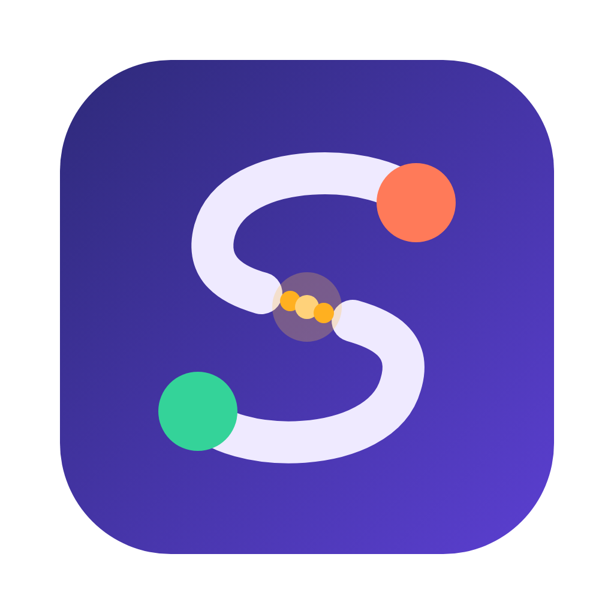

# Synapse

English | [한국어](README.ko.md)

Synapse is an IDE where several AI agents work in one workspace and a person
directs that collaboration from one screen. Its point is not to run several
agents. It is to **keep agents that work at the same time from breaking each
other's work**.

It ships first as a fork of the VS Code open-source code (Code - OSS). The
collaboration logic lives in **synapse-core**, a separate process with its own
API, so a later standalone IDE (or a fallback to a plain VS Code extension)
replaces only the UI. See [the plan](docs/plan.md).

> **Name.** Synapse is a non-profit project, so no trademark search was done
> (risk L3). Every product identifier lives in [`product.json`](product.json)
> and the package names, so a rename stays mechanical if a conflict comes up.

## What works today

- **One worktree per agent.** Each agent gets `.synapse/worktrees/<id>` on
  branch `synapse/<id>`, created and cleaned up automatically. Agents can only
  read and write inside their own worktree; your checkout is yours.
- **Agents over ACP.** Synapse is an [Agent Client Protocol](https://agentclientprotocol.com)
  client. Presets for Claude (its ACP adapter, on the Claude Agent SDK) and
  Codex, plus any ACP command. You use your own API keys or accounts; see
  [agent terms](docs/agent-terms.md).
- **Ownership down to the symbol.** tree-sitter (TypeScript, JavaScript,
  Python, Go, Rust, Java) records which functions, methods and classes each
  agent is changing, including uncommitted and untracked files.
- **Conflict warnings before the merge:**
  - two agents changing the same symbol;
  - one agent changing a function's signature while another agent's new code
    calls it the old way (this merges cleanly as text and still breaks);
  - changes that will not merge as text (`git merge-tree`, without touching
    any checkout);
  - two agents in the same file (informational).
- **Approvals.** Agents' permission requests show up on the board for you.
- **Combined review.** Merge all agents' work in an integration worktree, run
  your tests on the combined result, see one diff, then merge in one step.
  Merging is refused while tests fail or conflicts remain, unless you force it.
- **Task graph.** Split a goal into tasks, assign them, set dependencies.
  Finishing a task hands off to the next agent with the files and symbols it
  changed; dependent tasks can start automatically.
- **Structured messages and a decision log.** Agents message each other and
  propose decisions through a Synapse MCP server; their text is delivered as
  data, and anything that reads like instructions is held for you. Accepted
  decisions go into every task prompt. Pin a decision to the functions it is
  about, and Synapse tells you when an agent changes that code, and when it
  changes on your branch, so you can check the decision still holds.
- **Permission policies.** Per-agent rules for files, commands and network;
  everything else comes to you; everything is audited.
- **No telemetry.** Synapse collects nothing about you; crash reports are
  redacted and stay on your machine. The built-in GitHub Copilot is removed.
- **UIs:** a built-in extension (board, editor markers in each agent's
  color, conflicts in the Problems panel, status bar, review panel) and a
  `synapse` CLI. Both are clients of the same core API.

What is not built yet is listed in [docs/status.md](docs/status.md). New
here? Start with [getting started](docs/getting-started.md), then the
[user guide](docs/user-guide.md).

## Try it

Requires Node.js 22+ and git 2.38+.

```bash
npm ci
```

```bash
npm run build
```

```bash
npm test
```

Extension smoke test in a real VS Code (Linux needs `xvfb-run -a` in front):

```bash
npm run test:smoke -w extensions/synapse-collab
```

A two-agent demo with scripted agents, no API keys needed:

```bash
npm run demo
```

### With real agents (CLI)

Inside any git repository on a branch:

```bash
npx synapse agent add claude --start
```

```bash
npx synapse agent add codex --start
```

```bash
npx synapse agent prompt claude --wait "Add a cap parameter to applyDiscount and update callers"
```

```bash
npx synapse status
```

```bash
npx synapse review
```

`synapse --help` lists every command. Claude needs `ANTHROPIC_API_KEY` (or
Bedrock / Vertex AI credentials): Anthropic's terms do not let tools built on
its Agent SDK offer a Claude subscription login. Codex uses `OPENAI_API_KEY`
or your own Codex sign-in. See [agent terms](docs/agent-terms.md).

### In the editor

Development: open `extensions/synapse-collab` in VS Code (or any Code - OSS
build) and run it as an extension; it starts synapse-core for the open
repository. The Synapse IDE build bundles it as a built-in extension:

```bash
node build/build.mjs
```

That fetches the pinned Code - OSS tag, applies `patches/`, merges
`product.json`, adds the extension and runs the upstream build. It needs the
Node and pnpm versions in [`build/upstream.json`](build/upstream.json).

## Configuration

`synapse.config.json` at the repository root (commit it), with local overrides
in `.synapse/config.json`:

```json
{
  "baseRef": "main",
  "testCommand": "npm test",
  "setupCommand": "npm ci",
  "testTimeoutMs": 600000,
  "presets": { "claude": { "args": ["-y", "@agentclientprotocol/claude-agent-acp@0.109.1"] } }
}
```

## Repository layout

| Path | What |
| --- | --- |
| `packages/protocol` | The core API contract (types) and the JSON-RPC peer |
| `packages/core` | synapse-core: worktrees, ACP agents, ownership, conflicts, review, the local API server |
| `packages/client` | Client library for the core API |
| `packages/cli` | The `synapse` command, a second client that proves the core works without the IDE |
| `packages/mock-agent` | A scripted ACP agent for tests and demos (no model calls) |
| `extensions/synapse-collab` | The built-in extension: the first UI |
| `build/`, `patches/`, `product.json` | The fork: VSCodium-style build scripts, the core patch set (budget 20), branding |
| `resources/icons`, `resources/generated` | The Synapse mark and every icon generated from it (`node build/icons.mjs`) |
| `examples/` | Small repositories (JavaScript, Python) with two-agent scenarios |
| `docs/` | Plan, getting started, user guide, architecture, API, fork maintenance, privacy, release, status |

## License

MIT. Synapse builds on Code - OSS (MIT); upstream's license and third-party
notices ship with every build. Synapse is not affiliated with Microsoft, and
does not use the Visual Studio Code name or logo. Extensions come from
[Open VSX](https://open-vsx.org), not the Visual Studio Marketplace; see
[docs/fork-maintenance.md](docs/fork-maintenance.md).
